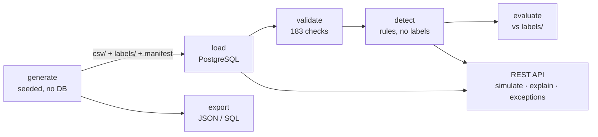

# Pricing & Promotion Simulator

A deterministic synthetic-data generator, pricing engine, anomaly injector, validator, detector and REST API for
retail pricing and promotions. It is built in Java 21 / Spring Boot 3 for the YottaFlex "Associate AI Forward Deployed
Engineer" challenge ([docs/challenge_brief.md](docs/challenge_brief.md)). From a fixed seed it produces a 180-day
pricing world for 5,000 SKUs and 2,000 promotions. Every price is explained by a stored decision, five labelled kinds
of edge case are injected into a valid baseline with the labels kept separate, and the pipeline proves it can find
every one of them.

**Status:** Tests: 338 passing. Full-scale validation: 0 structural failures, 250 business-rule findings
(50 per injected type), detection precision = recall = 1.0 for every type.

- [What this does](#what-this-does)
- [Prerequisites](#prerequisites)
- [Quick start](#quick-start-starter-scale)
- [Configuration](#configuration)
- [Full-scale run](#full-scale-run)
- [Verify it works](#verify-it-works-reviewer-checklist)
- [Data model](#data-model)
- [Pricing rules](#pricing-rules-summary)
- [Edge cases and ground truth](#edge-cases-and-ground-truth)
- [Design decisions](#design-decisions-and-trade-offs)
- [Assumptions and limitations](#assumptions-and-limitations)
- [Testing approach](#testing-approach)
- [Project structure](#project-structure)
- [Provenance](#provenance-and-lawful-use)
- [AI usage](#ai-usage)
- [Troubleshooting](#troubleshooting)

## What this does

**The problem.** A retailer prices thousands of SKUs every day. Each price must stay within guardrails: the floor
from landed cost and minimum margin or MAP, and the MRP ceiling. Prices react to competitors, but only on fresh data,
and promotions must stack according to their rules, with margin measured after discounts. Every price must be
explainable. To build and test such a system you need realistic, reproducible data with known problems in it. This
project generates that data, prices it with a real engine, plants labelled problems, and shows that validation and
detection find exactly those problems.

**Actors**

| Actor | Appears as |
|---|---|
| Customer | orders, presented coupons, demand |
| Store / warehouse operator | receipts, shrinkage, stockouts, replenishment |
| Merchandising analyst | promotions and rules, manual overrides, approval of large changes |
| Operations manager | guardrail-conflict approvals, the exception queue, validation summary |



## Prerequisites

- JDK 21 (`java -version`).
- Docker with Docker Compose v2 (`docker compose version`).
- bash, curl and coreutils (`sha256sum`). Python 3 is optional and only pretty-prints the API samples.
- About 3 GB of free disk for the full scale.
- No Maven install: the wrapper `./mvnw` downloads Maven.

## Quick start (starter scale)

```bash
git clone https://github.com/Saisrijan166/pricing-promo-simulator.git
cd pricing-promo-simulator
cp .env.example .env                 # change POSTGRES_PORT if 5432 is busy
./mvnw clean verify                  # build + 338 tests (H2), about 3 min
./scripts/run_all.sh starter         # docker up, generate, load, validate, detect, evaluate, export
```

Then start the API with `java -jar target/pricing-sim.jar` and open http://localhost:8080/swagger-ui.html.

`run_all.sh` runs each step as its own command. You can run them one by one:

```bash
docker compose up -d --wait
java -jar target/pricing-sim.jar generate --scale starter --seed 20261022 --out out/starter   # no DB needed
java -jar target/pricing-sim.jar load     --out out/starter    # Flyway migrates on startup
java -jar target/pricing-sim.jar validate --out out/starter    # validation_summary.json/.md; exit 1 on a structural FAIL
java -jar target/pricing-sim.jar detect   --out out/starter    # detected_exception table + detected_exceptions.csv
java -jar target/pricing-sim.jar evaluate --out out/starter    # evaluation_metrics.json (only step that reads labels/)
java -jar target/pricing-sim.jar export   --out out/starter --formats json,sql
```

Outputs go to `out/starter/` (git-ignored). The committed copy of the same run is in [data/sample/](data/sample).

## Configuration

**`.env`** (copied from `.env.example`). Docker Compose and the application both read it.

| Variable | Default | Meaning |
|---|---|---|
| `POSTGRES_DB`, `POSTGRES_USER`, `POSTGRES_PASSWORD` | `pricingsim` | Database and credentials |
| `POSTGRES_PORT` | `5432` | Host port published by Compose and used by the app |
| `POSTGRES_HOST` | `localhost` | Database host |
| `DB_URL` | built from the above | Full JDBC URL override |
| `SERVER_PORT` | `8080` | API port |

**`src/main/resources/application.yml`**

| Key | Meaning |
|---|---|
| `generator.seed` | Global seed (20261022) |
| `generator.default-scale` | Profile used without `--scale` (starter) |
| `generator.scales.{tiny,starter,full}` | `skus`, `days`, `promotions`, `start-date`, `anomalies-per-type`, `competitors` |
| `pricing.policy.*` | Engine thresholds: freshness 72 h, minimum match confidence 0.80, step limit 0.08, auto-approve 0.10, overstock 60 days, low cover 7 days, position offsets, default stack limit and discount cap ([docs/pricing_rules.md](docs/pricing_rules.md)) |

**CLI flags.** Every command takes `--scale` and `--out`; `generate`, `repro-check` and `run-all` also take the rest.

| Flag | Meaning |
|---|---|
| `--scale tiny\|starter\|full` | Base profile |
| `--seed <long>` | Override the seed |
| `--skus`, `--days`, `--promos`, `--start-date`, `--anomalies-per-type` | Override profile values (`--anomalies-per-type 0` gives a clean dataset) |
| `--out <dir>` | Dataset directory (default `out/<scale>`) |
| `--formats json,sql` | `export` / `run-all`: formats to write |

**Overriding a policy threshold.** Pass any `application.yml` key as a system property, for example
`java -Dpricing.policy.freshness-hours=48 -jar target/pricing-sim.jar generate --scale starter --out out/f48`. A changed
policy changes the data. The manifest records the policy, and `PricingPolicy.RULE_VERSION` should be bumped for a
permanent change.

## Full-scale run

```bash
java -Xmx2g -jar target/pricing-sim.jar run-all --scale full --out out/full --formats json
```

This is 5,000 SKUs × 180 days (01-01-2026 to 29-06-2026) × 2,000 promotions with 50 anomalies per type. The JSON export
is optional; the SQL seed is produced for the starter dataset only. Measured on a 4-CPU, 19 GB RAM Linux machine with PostgreSQL 16 in Docker ([docs/evidence/full_run_log.txt](docs/evidence/full_run_log.txt)):

| Stage | Time |
|---|---|
| generate (baseline dry run + injection run, no DB) | 73 s |
| load (4.2 M rows, one transaction) | 7 min 29 s |
| validate (183 checks) | 72 s |
| detect | 15 s |
| evaluate | 2 s |
| export (JSON Lines) | 26 s |
| **total `run-all`** | **10 min 45 s**, peak RSS 1.8 GB |

Row counts (from [docs/evidence/manifest_full.json](docs/evidence/manifest_full.json)):

| Table | Rows |
|---|---|
| product | 5,000 |
| product_status_event | 5,379 |
| cost_record | 29,000 |
| promotion | 2,000 |
| promotion_rule | 5,252 |
| promotion_product | 74,320 |
| promotion_status_event | 7,744 |
| competitor_observation | 534,705 |
| price_decision | 147,339 |
| price_decision_promotion | 45,385 |
| price_decision_observation | 305,541 |
| price_decision_status_event | 585,552 |
| price_history | 864,016 |
| inventory_snapshot | 864,016 |
| customer_order | 944,948 |
| order_promotion | 242,334 |
| labels/ground_truth.csv | 250 |

Results: [validation_summary_full.md](docs/evidence/validation_summary_full.md) and
[evaluation_metrics_full.json](docs/evidence/evaluation_metrics_full.json). The CSV output is about 770 MB (JSON export 1.7 GB).
Generation needs no database and also runs with `-Xmx768m`.

## Verify it works (reviewer checklist)

1. `./mvnw clean verify` → BUILD SUCCESS, 338 tests. Per-class counts are in
   [docs/evidence/test_report.txt](docs/evidence/test_report.txt).
2. `(cd data/sample && sha256sum -c checksums.sha256)` → every file OK.
3. `./scripts/repro_check.sh starter` → `Same seed 20261022: IDENTICAL`, `Different seed 20261023: DIFFERENT`
   ([starter report](docs/evidence/reproducibility_report_starter.md)). At full scale, `./scripts/repro_check.sh full`
   also gives IDENTICAL for all 18 files and DIFFERENT for seed 20261023, in about 6 minutes
   ([full report](docs/evidence/reproducibility_report.md)). Its fingerprint `1a275c73…` equals that of the
   `run-all` dataset in [manifest_full.json](docs/evidence/manifest_full.json).
4. Open `out/starter/validation_summary.md` (or [data/sample/validation_summary.md](data/sample/validation_summary.md)):
   0 structural failures, 25 business-rule findings (5 per injected type).
5. Open `out/starter/evaluation_metrics.json`: precision = recall = 1.0 for each of the 5 types.
6. **Swagger:** `java -jar target/pricing-sim.jar`, open http://localhost:8080/swagger-ui.html, run
   `POST /api/v1/pricing/simulate` with `{"skuId":"SKU-000001","asOfDate":"2026-01-05"}`, then
   `GET /api/v1/decisions/DEC-2026-000001/explain`.
7. **The three curl examples,** or `./scripts/api_smoke.sh`, which saves real responses to
   [docs/evidence/api_samples.md](docs/evidence/api_samples.md):

   ```bash
   curl -s -X POST localhost:8080/api/v1/pricing/simulate -H 'Content-Type: application/json' \
     -d '{"skuId":"SKU-000001","asOfDate":"2026-01-05","overrides":{"onHandUnits":0}}'
   curl -s localhost:8080/api/v1/decisions/DEC-2026-000001/explain
   curl -s 'localhost:8080/api/v1/exceptions?category=ANOMALY&size=5'
   ```

8. **SQL spot checks** (`docker compose exec postgres psql -U pricingsim -d pricingsim`), each expected to return 0:

   ```sql
   -- Every price is explainable: each price_history row has a decision, except the labelled
   -- PRICE_CHANGE_WITHOUT_REASON spans (5 per type at starter, flagged by the detector)
   SELECT COUNT(*) FROM price_history ph
    WHERE ph.source_decision_id IS NULL
      AND ph.sku_id NOT IN (SELECT sku_id FROM detected_exception WHERE issue_type = 'PRICE_CHANGE_WITHOUT_REASON');

   -- No list price below its floor except the labelled PRICE_BELOW_FLOOR decisions
   SELECT COUNT(*) FROM price_decision d
    WHERE d.final_list_price < d.floor_price
      AND d.decision_id NOT IN (SELECT entity_id FROM detected_exception WHERE issue_type = 'PRICE_BELOW_FLOOR');

   -- Inventory reconciles: closing = opening + receipts - sold + adjustment
   SELECT COUNT(*) FROM inventory_snapshot
    WHERE closing_on_hand <> opening_on_hand + receipts_units - units_sold + adjustment_units;
   ```

## Data model

These documents describe the model in full:
[ER diagram](docs/er_diagram.md) · [data dictionary](docs/data_dictionary.md) ·
[ID conventions](docs/id_conventions.md).

There are 16 data tables: 9 entities, 4 bridge tables (promotion ⇄ product, order ⇄ promotion,
decision ⇄ promotion, decision ⇄ observation) and 3 status-event histories. The database also has 3 pipeline output
tables.

| Entity | Key | Notes |
|---|---|---|
| `product` | `SKU-000001` | MRP, MAP, minimum margins, price position, lifecycle NEW / ACTIVE / DISCONTINUED |
| `cost_record` | `COST-SKU-000001-2026-01` | Monthly; landed = unit + freight; contiguous effective periods |
| `price_history` | `PRC-SKU-000001-20260101` | Daily list and shelf price; source decision and change reason |
| `competitor_observation` | `OBS-2026-0000001` | Captured and ingested times, match confidence |
| `inventory_snapshot` | `INV-SKU-000001-20260101` | Daily flow, lost sales, stockout flag, days of cover |
| `promotion` | `PROMO-2026-000001` | Markdowns (Mon→Sun) and coupons; lifecycle DRAFT → … → EXPIRED / CANCELLED |
| `promotion_rule` | `RULE-2026-000001` | EXCLUSIVE, EXCLUDES_PROMOTION, MAX_STACK_COUNT, MAX_COMBINED_DISCOUNT_PCT, MIN_ORDER_QTY |
| `customer_order` | `ORD-2026-0000001` | Single-SKU line; gross, discount, net and margin derived |
| `price_decision` | `DEC-2026-000001` | Every stored input, outcome, reason codes and the S1–S12 explanation |

## Pricing rules summary

`PricingEngine` is pure Java, and the generator and the API use the same instance. Full rules and a worked example
are in [docs/pricing_rules.md](docs/pricing_rules.md).

| Step | Rule |
|---|---|
| S1 | Snapshot the inputs visible at 06:00Z |
| S2 | Floor = roundUp(max(landed / (1 − min_margin), MAP)) |
| S3 | Ceiling = MRP; ceiling below floor is a guardrail conflict: price at the floor and escalate |
| S4 | Competitor reference: latest per competitor, fresh (≤ 72 h on capture time) and confident (≥ 0.80); median |
| S5 | Target = reference × position offset, else the previous price, else MRP × 0.95 |
| S6 | Stockout: hold and suppress markdowns. Overstock: −3%. Low cover with high velocity: +3% |
| S7 | Step limit ±8% |
| S8 | Clamp to [floor, ceiling] |
| S9 | Price point (…9 from ₹100) |
| S10 | Markdown stacking in (priority, promotion_id) order |
| S11 | Margin on the net price; drop the last markdown until it passes |
| S12 | Decision type, escalation above 10%, reason codes |

## Edge cases and ground truth

Five types are injected, with consistent arithmetic, through the real engine and simulator
([docs/anomalies_and_ground_truth.md](docs/anomalies_and_ground_truth.md)):

| Type | Injection | Detector rule |
|---|---|---|
| PRICE_BELOW_FLOOR | Analyst override below the floor | Recomputed floor > final price |
| PROMO_STACK_VIOLATION | Conflicting coupon forced to APPLIED | Stacking rules re-run on the applied set |
| STALE_OBSERVATION_AS_CURRENT | Observation older than 72 h used | USED observation older than 72 h at decision time |
| MARGIN_BEFORE_DISCOUNT | Margin judged and stored on the list price | Stored margin ≠ net margin, which is below required |
| PRICE_CHANGE_WITHOUT_REASON | Mid-week change with no reason or decision | Price changed with no reason or decision |

- **Separate labels.** The labels live only in `labels/ground_truth.csv` and `.json`. No data table has a label
  column. The loader loads only the registry tables, and only `evaluate` reads the labels.
- **Leakage checks.** `NoLeakageTest` scans headers and file contents, and checks that the detection, validation, API,
  service and persistence code never touches labels or the anomaly code.
- **Clean baseline.** `--anomalies-per-type 0` gives a dataset with zero business-rule findings.

The pipeline also reports operational exceptions: decisions on stale competitor data, guardrail conflicts, stockouts
and rejected coupons.

## Design decisions and trade-offs

All 16 ADRs are in [docs/design_decisions.md](docs/design_decisions.md). The top five:

1. **Business rules in the validator and detector, not DB constraints.** Anomalies must stay loadable to be found.
2. **Reproducibility by construction.** `java.util.Random` streams seeded from SHA-256(seed|stream|key), `StrictMath`,
   a single-threaded day loop and PK-sorted output. A source-scan test forbids clocks, `Math` and hash ordering.
3. **One engine for the generator and the API.** Stored decisions replay identically from the database
   (`EngineReplayIT`).
4. **Anomalies from a baseline dry run, at most one per SKU,** injected through the engine's explicit `Faults`.
   Everything not labelled is identical to the clean run.
5. **CSV is canonical and checksummed;** JSON and SQL are derived. Only the starter dataset is committed; full scale is
   evidence plus the seed.

## Assumptions and limitations

**Assumptions** (PLAN.md §2):
- The window is 01-01-2026 to 29-06-2026. All times are UTC, and the business date is the UTC date.
- Money is INR without GST. MRP is the ceiling; MAP feeds the floor.
- Margin is always computed on the net price after discounts, against the landed cost of that date.
- Cost changes monthly. Prices change only through decisions: INITIAL, Monday WEEKLY_REVIEW, COST_CHANGE on the 1st,
  and STOCKOUT_EVENT.
- Markdowns run Monday to Sunday; coupons are presented per order.
- Competitor freshness is 72 h on capture time.
- Orders are single-SKU lines; customers are opaque tokens.
- Inventory is held at one network level.
- Competitors are fictional; latent demand parameters are never exported.

**Limitations:**
- **Simple demand model.** Demand uses constant elasticity. Competitors do not react to our prices. There is no
  cannibalisation, returns, baskets, tax or multi-location stock.
- **Simulated escalations.** Escalations are always approved the same day; REJECTED decisions are valid but not
  generated.
- **Detection scores mean label integrity.** The detector mirrors the engine's rules, so precision and recall of 1.0
  are expected: they prove the labels are exact and the baseline is clean, not that the detector is clever.
- **Guardrail conflicts exceed MRP.** In a conflict the price is set at the floor, which is above MRP, and escalated
  (PLAN §8 S3, ADR-11). MRP is legally a hard ceiling in India, so production would block this instead.
- **One realism band is WARN.** The share of competitor observations that are stale at decision time is about 21% (21.2% starter, 21.7% full)
  against the PLAN.md §7.5 band of 5–15%. This is a direct consequence of two other PLAN.md choices: COMP_GAMMA
  observes weekly, so its latest observation is older than the 72 h freshness window on about 4 days in 7, and 8% of
  competitor-SKU pairs have 7–20 day gaps. The plan's cadence and freshness rule were kept rather than tuning the data
  to the band; the realistic effect is that 9,385 full-scale decisions (6.4%) fall back to non-competitor pricing and are
  reported as COMPETITOR_DATA_STALE exceptions. All six other bands are inside their ranges at both scales
  (stockouts 5.0%, SKU-days under markdown 16.7%, coupon rejections 25.5%, realised margin 37.4%, 1.77 price changes
  per SKU-month, top-20% SKU share 66.5% at full scale).
- **Postgres behaviour is checked manually.** Tests run on H2 in PostgreSQL mode; PostgreSQL behaviour is checked by
  `run_all.sh` and the fresh-clone test.
- **Fixed-width IDs.** For example DEC-YYYY has 6 digits per year; the generator fails fast before a scale would
  overflow.

## Testing approach

338 tests run with `./mvnw clean verify`: 299 unit tests (Surefire) and 39 integration tests (Failsafe,
H2 in PostgreSQL mode).

| Layer | Examples |
|---|---|
| Pure units | Calculators, stack resolver (shuffled-input invariance), price points, 72 h boundary, RNG and distributions |
| Golden scenarios | 20 hand-computed pricing cases, with arithmetic in each case's `notes` |
| Generator | Row counts per profile; derived values reconcile; byte-identical determinism; spill equivalence; source-scan rules |
| Anomalies | Exactly N per type; each label breaks exactly its rule; untouched SKUs equal the clean run; leakage scans |
| Integration (H2) | Flyway schema; bulk load; every validation check with 8 broken-dataset fixtures; generate → load → validate → detect → evaluate; engine replay of 100 decisions; JSON / SQL export |
| API (MockMvc) | Success paths, 400 validation, 404 ProblemDetail, filters, stable paging |
| End to end | `run_all.sh`, `repro_check.sh` and `fresh_clone_test.sh` against PostgreSQL |

## Project structure

```
├── PLAN.md, PROMPT_HISTORY.md, AI_USAGE.md, README.md, LICENSE
├── docker-compose.yml, .env.example, pom.xml, mvnw
├── data/sample/              committed starter dataset: csv/ json/ sql/ labels/ manifest checksums summaries
├── docs/                     brief, ER, data dictionary, IDs, pricing rules, generator, anomalies,
│   └── evidence/             validation, API, provenance, design decisions; full-scale and test evidence
├── scripts/                  run_all, repro_check, api_smoke, fresh_clone_test, extract_prompt_history
└── src/main/java/com/pricingsim/
    ├── domain/               records, enums, IdFactory
    ├── pricing/              PricingEngine (S1–S12) and calculators: pure Java
    ├── generator/            rng, master data, day-loop simulator, anomaly injection, sinks
    ├── io/                   TableRegistry, CSV rules, manifest, checksums, JSON/SQL export
    ├── persistence/          bulk loader, DAOs
    ├── validation/           183 checks, summary writer
    ├── detection/            rule detectors, operational exceptions
    ├── evaluation/           ground-truth scores, realism metrics
    ├── service/, api/        REST API (springdoc, ProblemDetail)
    └── cli/                  picocli commands
```

## Provenance and lawful use

All data is synthetic and generated from a seed. No external, scraped or personal data is used. Brands, products and
competitors are fictional, and customers are opaque tokens. The code and data are under the MIT licence. See
[docs/provenance.md](docs/provenance.md).

## AI usage

This project was built with Claude Code. [AI_USAGE.md](AI_USAGE.md) describes where AI was used, how much I relied on
it, and what I reviewed, changed and validated. [PROMPT_HISTORY.md](PROMPT_HISTORY.md) records every prompt verbatim,
with what came out of it and how it was verified.

## Troubleshooting

| Problem | Fix |
|---|---|
| Port 5432 already in use | Set `POSTGRES_PORT=5433` (any free port) in `.env`; Compose and the app both read it |
| `Cannot connect to the Docker daemon` | Start Docker; `docker compose ps` should show postgres `healthy` |
| `This command needs the database` | `docker compose up -d --wait` first; only `generate`, `export` and `repro-check` run without it |
| Wrong Java (`release version 21 not supported`) | Point `JAVA_HOME` at a JDK 21 |
| Out of memory at full scale | Run with `java -Xmx2g …` (generation also works with 768 MB) |
| Checksums differ on Windows | `.gitattributes` forces LF for csv/sql/json/sh; clone with Git's default autocrlf or use WSL |
| A command fails with a short `Error:` line | Re-run with `PRICING_SIM_DEBUG=1` to print the stack trace |
