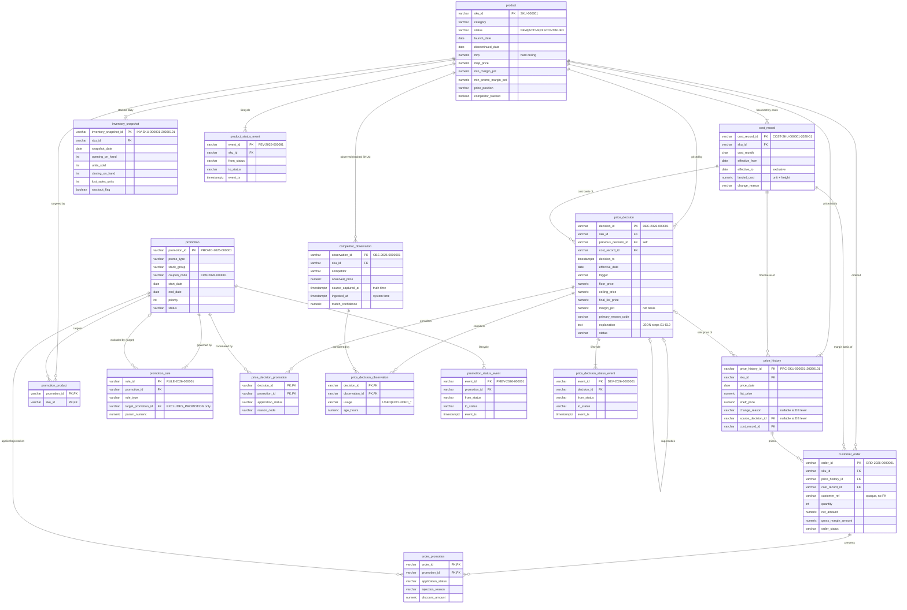
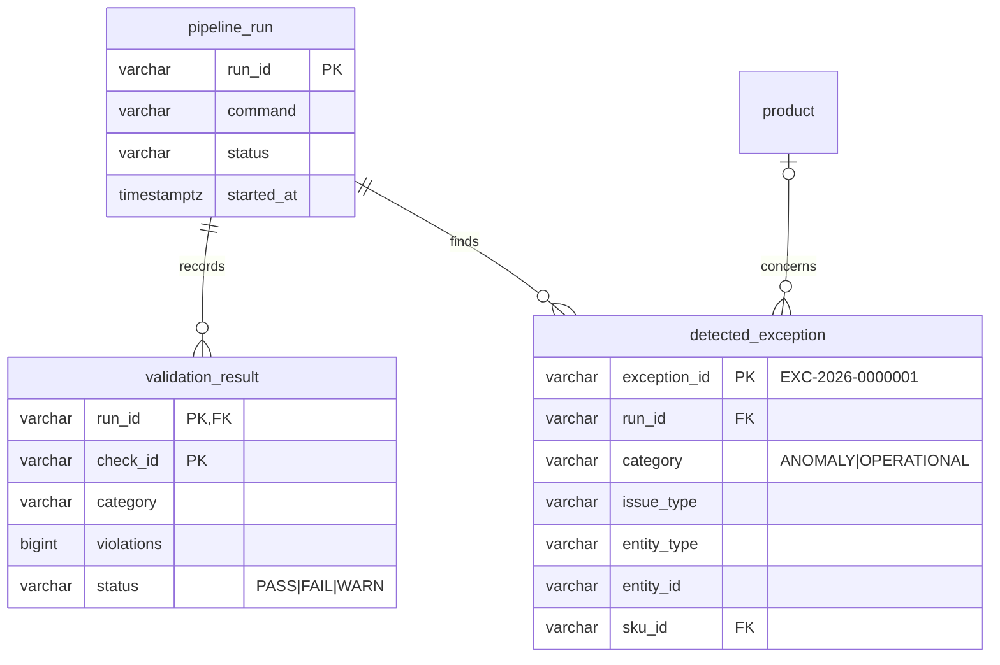
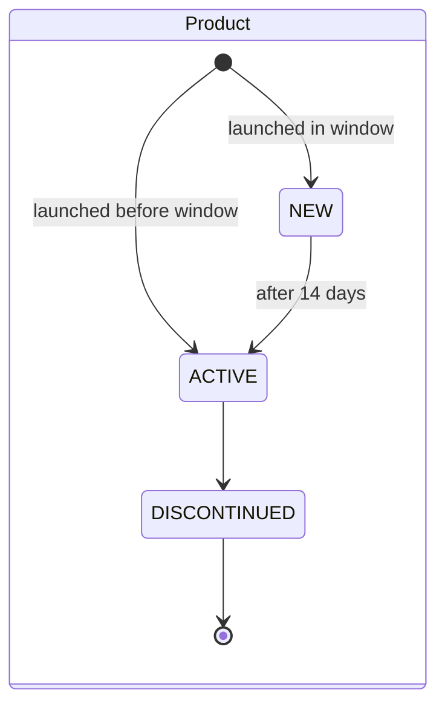
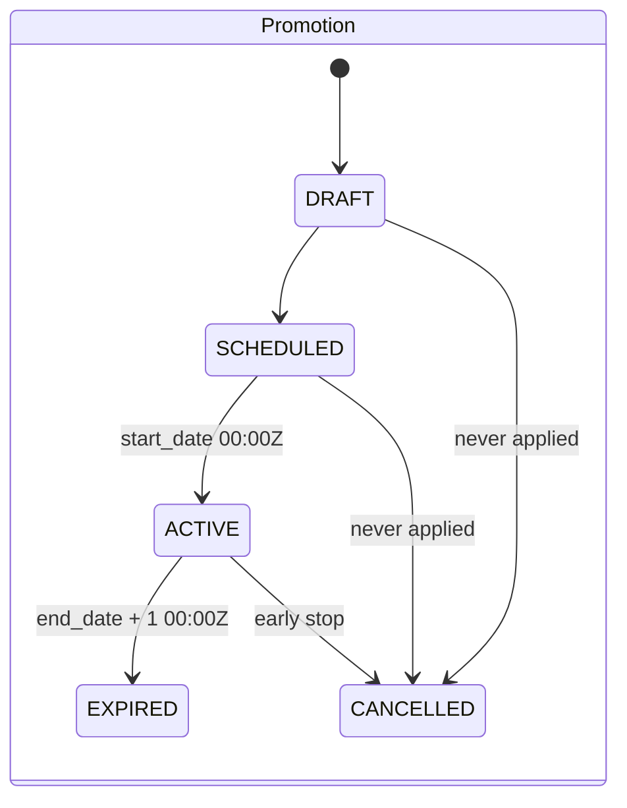
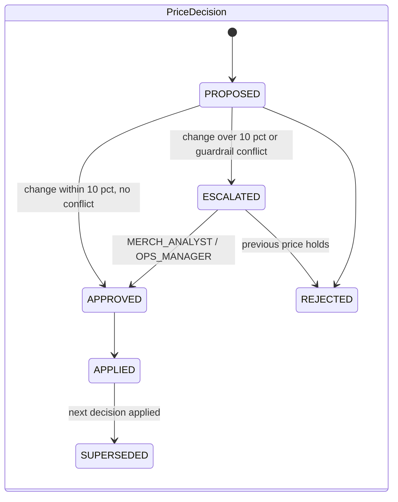

# ER diagram

9 core entities, 4 bridge tables (N:M), 3 event-history tables and 3 pipeline output tables, 19 tables in all
(PLAN §4). Field-level detail is in [data_dictionary.md](data_dictionary.md) and ID formats are in
[id_conventions.md](id_conventions.md).

## Data model

Key columns and the main attributes are shown. `PK` = primary key, `FK` = foreign key.

### Pipeline output tables

## Relationships and cardinality

"Optional?" describes the child's participation: whether every parent must have children, and whether the FK column may be null.

| # | Parent → Child | Card. | FK column | Optional? | Notes |
|---|---|---|---|---|---|
| 1 | product → cost_record | 1:N | `cost_record.sku_id` | Mandatory (≥1 per active month) | Effective periods do not overlap |
| 2 | product → price_history | 1:N | `price_history.sku_id` | Mandatory (1 per active day) | |
| 3 | product → competitor_observation | 1:N | `competitor_observation.sku_id` | Optional (only `competitor_tracked = true`) | |
| 4 | product → inventory_snapshot | 1:N | `inventory_snapshot.sku_id` | Mandatory (1 per active day) | |
| 5 | product → customer_order | 1:N | `customer_order.sku_id` | Optional | |
| 6 | product → price_decision | 1:N | `price_decision.sku_id` | Mandatory (≥1: INITIAL) | |
| 7 | product ⇄ promotion | N:M | via `promotion_product` | Optional | |
| 8 | promotion → promotion_rule | 1:N | `promotion_rule.promotion_id` | Mandatory (≥1) | |
| 9 | promotion → promotion_rule (target) | 1:N | `promotion_rule.target_promotion_id` | Optional (only `EXCLUDES_PROMOTION`) | Self-relationship via rule |
| 10 | cost_record → price_decision | 1:N | `price_decision.cost_record_id` | FK mandatory | Cost basis used |
| 11 | cost_record → price_history | 1:N | `price_history.cost_record_id` | FK mandatory | For floor reconciliation |
| 12 | cost_record → customer_order | 1:N | `customer_order.cost_record_id` | FK mandatory | Margin basis |
| 13 | price_decision → price_history | 1:N | `price_history.source_decision_id` | Nullable at DB level (null = anomaly) | One decision sets 1..n days |
| 14 | price_decision → price_decision | 1:0..1 | `price_decision.previous_decision_id` | Optional (null for INITIAL) | Supersession chain |
| 15 | price_history → customer_order | 1:N | `customer_order.price_history_id` | FK mandatory | Order price traceable to the day's price |
| 16 | customer_order ⇄ promotion | N:M | via `order_promotion` | Optional | Includes REJECTED coupon attempts |
| 17 | price_decision ⇄ promotion | N:M | via `price_decision_promotion` | Optional | APPLIED / REJECTED with reason |
| 18 | price_decision ⇄ competitor_observation | N:M | via `price_decision_observation` | Optional | USED / EXCLUDED_* with age |
| 19 | product → product_status_event | 1:N | `product_status_event.sku_id` | Mandatory (≥1) | Event history, never overwritten |
| 20 | promotion → promotion_status_event | 1:N | `promotion_status_event.promotion_id` | Mandatory (≥1) | Event history, never overwritten |
| 21 | price_decision → price_decision_status_event | 1:N | `price_decision_status_event.decision_id` | Mandatory (≥1) | Event history, never overwritten |
| 22 | pipeline_run → validation_result | 1:N | `validation_result.run_id` | Optional | Output |
| 23 | pipeline_run → detected_exception | 1:N | `detected_exception.run_id` | Optional | Output |
| 24 | product → detected_exception | 1:N | `detected_exception.sku_id` | Nullable | Output |

`customer_order.customer_ref` is an opaque synthetic token (`CUST-0000001`). Customer is not one of the 9 entities,
so it has no FK, by design (PLAN §2 assumption 10).

"Every price is explainable" follows this chain:
`price_history.source_decision_id` → `price_decision` (stored inputs + explanation) → `cost_record`;
`price_decision_observation` → `competitor_observation`; `price_decision_promotion` → `promotion` → `promotion_rule`.

## Lifecycle states

State changes are appended to the `*_status_event` tables. The parent's `status` column equals the last event.

| Entity | Allowed transitions |
|---|---|
| Product | `∅→ACTIVE`, `∅→NEW`, `NEW→ACTIVE`, `ACTIVE→DISCONTINUED` (terminal). No decisions or orders after `discontinued_date`. |
| Promotion | `∅→DRAFT`, `DRAFT→SCHEDULED`, `SCHEDULED→ACTIVE`, `ACTIVE→EXPIRED`, `DRAFT→CANCELLED`, `SCHEDULED→CANCELLED`, `ACTIVE→CANCELLED`. Nothing is applied after a cancel timestamp. |
| PriceDecision | `∅→PROPOSED`, `PROPOSED→APPROVED`, `PROPOSED→ESCALATED`, `ESCALATED→APPROVED`, `PROPOSED→REJECTED`, `ESCALATED→REJECTED`, `APPROVED→APPLIED`, `APPLIED→SUPERSEDED`. |

## Effective dates

| Table | Fields | Semantics |
|---|---|---|
| cost_record | `effective_from`, `effective_to` | Inclusive / exclusive; monthly; `effective_to` null on the latest record |
| promotion | `start_date`, `end_date` | Both inclusive; markdowns run Monday → Sunday |
| promotion_rule | `effective_from`, `effective_to` | Inside the promotion window |
| product | `launch_date`, `discontinued_date` | Active window |
| price_decision | `decision_ts`, `effective_date` | When computed (06:00Z) / when the price applies (same day) |
| price_history, inventory_snapshot | `price_date`, `snapshot_date` | Daily |
| competitor_observation | `source_captured_at`, `ingested_at` | Truth time / system time (≥ capture); freshness uses capture time |
